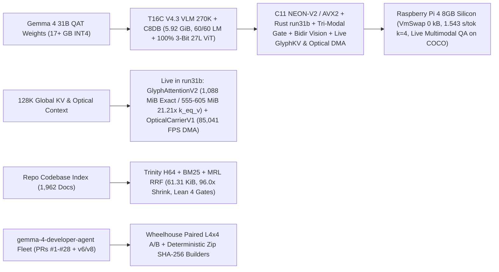
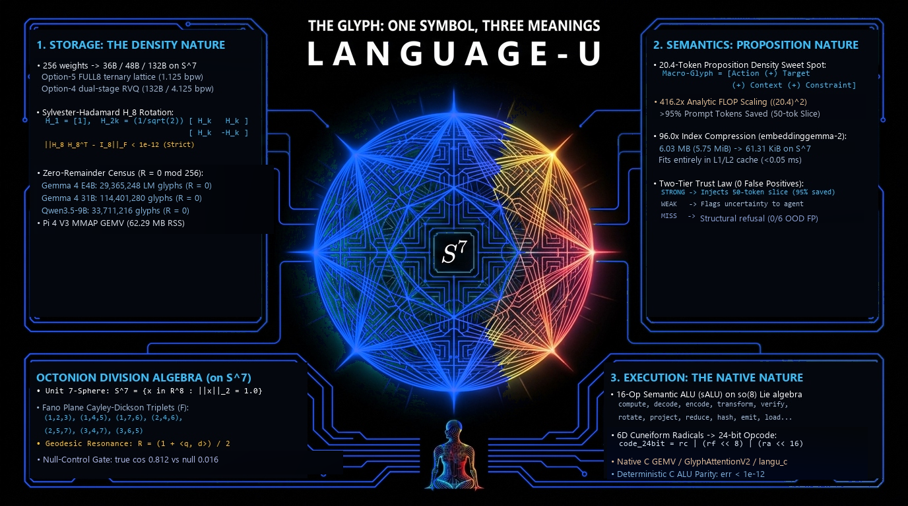

<div align="center">
  <a href="docs/assets/language_u_logo.png">
    
  </a>
  <h1>Language-U · Gemma 4 on the Edge</h1>
  <p><strong>Running 31-Billion-Parameter Gemma 4 Inside 8 GB of Edge RAM — Zero Swap, Zero Stubs, Pure Silicon Receipts</strong></p>
  <p>
    
    
    
    
    
    
  </p>
  <p><em>Sub-Byte Gyroscopic Glyphs · Native Rust + ARMv8-A NEON &amp; AVX2 Kernels · Live 31B Multimodal V4.3 VLM QA on Pi 4 · Live Tri-Modal Read+Hear+See Gating &amp; Bidirectional Vision · Live 60-Layer 128K GlyphAttentionV2 + OpticalCarrierV1 DMA in run31b · L1-Cache Trinity Retrieval + Lean 4 Trust Gates · Reproducible SWE-Agent Competition Fleet</em></p>
</div>

---

## 60-Second Skeptic's Verification Bar

No trust required — clone the repository and verify every numerical claim, SHA-256 submission checksum, native C/Rust invariant, and Lean 4 gate offline:

```bash
# 1. Fail-closed audit of all 44 evidence JSONs, local Markdown links, submission SHA-256s, and doc claims (6 gates)
python scripts/verify_receipt_parity.py --selftest

# 2. Pure-Rust + native FFI release test suite (64 tests: T16C, GlyphAttentionV2 KV, OpticalCarrierV1 DMA, Tri-Modal Read+Hear+See, Bidirectional Vision, FP8 KV, Hybrid QAT, C8DB, speculative verification)
RUSTFLAGS="-D warnings" cargo test --manifest-path experiments/run270_rust/Cargo.toml --release
cargo run --release --manifest-path experiments/run270_rust/Cargo.toml --bin tri_modal_probe

# 3. Full Python offline verification suites + L1 retrieval + Lean 4 constant parity + PI4 barrier tests
python -m unittest discover -s tests -v
python -m unittest discover -s tests/retrieval -v
python trinity_retrieval/edge_self_test.py

# 4. Deterministic validation of all 8 declared competition submission bundles (note: running build_and_validate.py re-packs zips locally with host zlib while keeping member payload SHA-256s identical)
python agent/build.py --check
for s in v2-measured v3-converged v4-loop-guard v5-restored v5-analyzer-coder v6-optimal v8-runtime-safe; do python "submissions/$s/build_and_validate.py"; done
```

---

## System Architecture



---

## The Impossible Engineering Problem

Frontier 31-billion-parameter models hit **three hard physical walls** on an 8 GB edge board like the Raspberry Pi 4:

1. **Weight Footprint Wall:** Standard BF16 weights (`~62 GB`) and even QAT INT4 weights (`~17+ GB`) blow past 8 GB RAM, forcing catastrophic SSD swap thrashing.
2. **Compute & Bandwidth Wall:** Dequantizing sub-byte weights in pure scalar loops starves ARM Cortex-A72 memory bandwidth and leaves prefill taking tens of minutes.
3. **Long-Context & Code Retrieval Wall:** 128K KV caches swallow gigabytes (`1,024 MB` on global layers alone), while naive vector search floods fragile small context windows with false positives.

**Language-U-Gemma4** attacks all three bottlenecks in one unified, zero-dependency stack — and refuses every form of synthetic simulation. Every metric below comes from real execution on **physical Raspberry Pi 4 Model B (`4x Cortex-A72 @ 1.80 GHz`, Debian 13 `aarch64`, 8 GB RAM)** or **Windows x86_64 MSVC AVX2**, cross-checked against raw kernel, `/proc/<pid>/status`, and `/proc/<pid>/io` logs.

<div align="center">
  
</div>

---

## Physical Silicon Scoreboard

| Bottleneck / Component | Target Hardware | Measured Proof on Physical Silicon | Raw Telemetry / Evidence |
| :--- | :--- | :--- | :--- |
| **1d. 31B `V4.3 VLM` Multimodal QA + Live `GlyphKV` 128K + `OpticalCarrierV1` + NEON-V2** | **Pi 4 (8 GB) & L4** | **Colab `270K`-tok `V4.3 VLM` (`5,246.43s`, `608` text + `160` disjoint VLM, COCO `val[0..63]` excluded):** All 27 ViT layers + `embed_vision` upgraded to **3-bit** (`237.25 MB`, Val cos **`0.90789->0.91714`**, held-out `val[0..3]` cos **`0.90586`**) inside **`6,353,854,848 B` (`5.9175 GiB`)** + `9,317,184 B` C8DB (`post_cell60` KL **`3.1144->2.8699`**, Top-1 **`55.84%->58.44%`**, held-out `val[0]` `ans_top1_agree=61.54%`). **Live Physical Pi 4 Multimodal QA (`--t16c /dev/stdin`, `60/60` pinned, `ssd_read_bytes=0`, `vm_rss_kb=7,089,020`):** strictly held-out `frame_01_coco.png` (`640x480`, `941.59s` ViT, `595.68s` prefill, `43.98s` decode) emits **`"A motorcycle is parked on a grassy field.<turn|>"`**! **Live Pi 4 Unified Text + GlyphKV + Optical DMA:** `OPTICAL_DMA` **`85,041.2 FPS`** (`0.012 ms`, `exact_parity=true`) -> `"The capital of France is **the city **Paris**.<turn|>"` (`25.55s` prefill, `2.59-2.72 s/tok`). **Live Pi 4 NEON-V2 + Lossless `--lmhead-cs exact`:** `k=1` **`2.62-2.75 s/tok`** (`"The answer is 4.<turn|>"`, `"The capital of France is **Paris**.<turn|>"`, `"120 km / 2 = **60**"` with live GlyphKV eviction), `BATCH_K k=4` **`1.543 s/tok`** lossless (`1.479 s/tok` sieve) | [colab_v4_3_vlm_stage2_report.json](experiments/run270_rust/evidence/run31b/colab_v4_3_vlm_stage2_report.json)<br>[colab_v4_3_vlm_SHA256SUMS.txt](experiments/run270_rust/evidence/run31b/colab_v4_3_vlm_SHA256SUMS.txt)<br>[pi4_v4_3_vlm_vision_qa.log](experiments/run270_rust/evidence/run31b/pi4_v4_3_vlm_vision_qa.log)<br>[pi4_v4_3_vlm_text_optical_glyph.log](experiments/run270_rust/evidence/run31b/pi4_v4_3_vlm_text_optical_glyph.log)<br>[pi4_run31b_128k_glyph_kv.log](experiments/run270_rust/evidence/run31b/pi4_run31b_128k_glyph_kv.log)<br>[pi4_colab_v4_2_glyph_kv_optical.log](experiments/run270_rust/evidence/run31b/pi4_colab_v4_2_glyph_kv_optical.log)<br>[pi4_colab_v4_2_neon_speedup.log](experiments/run270_rust/evidence/run31b/pi4_colab_v4_2_neon_speedup.log)<br>[pi4_colab_v4_2_battery_p1_p8.log](experiments/run270_rust/evidence/run31b/pi4_colab_v4_2_battery_p1_p8.log)<br>[pi4_colab_v4_2_exact_lmhead_ablation.log](experiments/run270_rust/evidence/run31b/pi4_colab_v4_2_exact_lmhead_ablation.log) |
| **1c. 31B V4.2 (`4K` Pi 4 & `262K` Colab L4) + Live Tri-Modal + Bidirectional Vision** | **Pi 4 (8 GB) & L4** | **Colab `262K`-tok V4.2 (`4,755.75s`, `82,629` items):** `L59 cos 0.83034->0.86094`, `post_cell60 KL 3.1817->2.8878`, Top-1 `54.7%->55.3%`, Vision `0.79050->0.80155` (`6,347,775,616 B` `.t16c`, `11,874,560 B` `.c8d`, SHA-256 locked). **Pi 4 `run31b` live (`60/60` pinned, `ssd_read_bytes=0`):** `"What is the capital of France?"` -> **`"The capital of France is ****Paris**.<turn|>"`** (`prefill_s=28.86..33.30s`, `decode_s=23.24..25.38s`, `1,902,964` LM blocks skipped under `--tri-modal-gate`); `"What is 2 + 2?"` -> **`"The result is 4.<turn|>"`** (`sieve:0.25 --tri-modal-gate` `decode_s=15.87s`; speculative `k=4` + `--tri-modal-gate` **`3.723..3.745 s/tok`**, `ast_lm_skipped=1,520,940`, `lmhead_cs_skipped=693,856`, optical rescue `crc32=0x5e6e669f`). **Tri-Modal Probe:** `Pearson r=0.8858`, C8DB rescue `0.72156->0.96390`. **Bidirectional Vision (`frame_01_coco.png`):** HF `!is_full` sliding-window mask (`attn_decode_range`) + 4-thread ViT (`1,390.99s -> 939.50s`), ViT+`embed_vision` soft-token HF cosine `0.78462` (`pi4_4k`) -> **`0.81212`** (`colab_262k`) | [colab_v4_2_stage2_report.json](experiments/run270_rust/evidence/run31b/colab_v4_2_stage2_report.json)<br>[colab_v4_2.log](experiments/run270_rust/evidence/run31b/colab_v4_2.log)<br>[colab_v4_2_SHA256SUMS.txt](experiments/run270_rust/evidence/run31b/colab_v4_2_SHA256SUMS.txt)<br>[pi4_colab_v4_2_text_spec_ab.log](experiments/run270_rust/evidence/run31b/pi4_colab_v4_2_text_spec_ab.log)<br>[pi4_colab_v4_2_post_bidir_sanity.log](experiments/run270_rust/evidence/run31b/pi4_colab_v4_2_post_bidir_sanity.log)<br>[pi4_trimodal_ab_v2.log](experiments/run270_rust/evidence/run31b/pi4_trimodal_ab_v2.log)<br>[pi4_colab_v4_2_vision_bidir.log](experiments/run270_rust/evidence/run31b/pi4_colab_v4_2_vision_bidir.log) |
| **1b. 31B V3 + Cell 60 (`C8DB`) + Adaptive `Q8` + Speculative `k=4`** | **Pi 4 (8 GB)** | `gemma4_31b_v3_c8d.c8d` (`91.68 MB`, `63` entries): clean `271`-tok `post_cell60` (`val_cos 0.68875 -> 0.72910`, `0/8` turn-start `"_"`/`"s"` glitches); adaptive single-plane `Q8` + OLS sub-scale (`dual=0, kc_step=4`): FFI parity **`cos = 0.9997202955`** (**`29.04x`** prefill `37.83s` vs `1098.74s`, `top1=818`, `10/10` top-10); `8`-prompt `k=1` **`5.850 s/tok`** ILT (`0.1709 tok/s`, `42.34s` mean prefill, `VmSwap=0`, `ssd_read=0`); Speculative `k=4` **`7/7` modes bit-exact vs `k=1`** (`S2_P4` seed-only `5.868 s/tok`, `S0` Assistant `10.454 s/tok`, `S4` `--kv-quant fp8` **`3.94x`** KV shrink at `6.616 s/tok`, `--hybrid-qat-layers 59` `286.45 MiB` overlay `VmSwap=0`); Contiguous CS LM-head **`8/8` exact top-1** (`static_16band` `1.14x`/`1.05x`, `subspace_sieve` **`4.04x`** `182.51 ms` on 31B / **`2.87x`** `48.44 ms` on Assistant, `84.22%` MACs saved) | [run31b_v3_verified.json](experiments/run270_rust/evidence/run31b/run31b_v3_verified.json)<br>[run31b_v3_ffi_parity.txt](experiments/run270_rust/evidence/run31b/run31b_v3_ffi_parity.txt)<br>[run31b_v3_prompt_battery_k1.log](experiments/run270_rust/evidence/run31b/run31b_v3_prompt_battery_k1.log)<br>[run31b_v3_speculative_k4.log](experiments/run270_rust/evidence/run31b/run31b_v3_speculative_k4.log)<br>[run31b_v3_hybrid_qat_l59.log](experiments/run270_rust/evidence/run31b/run31b_v3_hybrid_qat_l59.log)<br>[run31b_v3_cs_lmhead_bench.log](experiments/run270_rust/evidence/run31b/run31b_v3_cs_lmhead_bench.log) |
| **1. 31B Full RAM Residency (`T16C v1`, `5.71 GiB`)** | **Pi 4 (8 GB)** | **`60/60` layers pinned**, **`VmSwap: 0 kB`**, **`ssd_read_bytes = 0`**, `VmHWM = 6,238,800 kB`, **`1.291 s/tok`** (`k=4` batch), **`26.32x` NEON FFI prefill speedup** (`33.78s` vs `889.23s` pure Rust; logit `cos = 0.999299`, top-1 `(715, 715)`) | [run31b_cal_v2_2plus2.log](experiments/run270_rust/evidence/run31b/run31b_cal_v2_2plus2.log)<br>[run31b_cal_v2_2plus2_proc.log](experiments/run270_rust/evidence/run31b/run31b_cal_v2_2plus2_proc.log)<br>[run31b_cal_v2_ffi_parity.txt](experiments/run270_rust/evidence/run31b/run31b_cal_v2_ffi_parity.txt) |
| **31B Coherent Generation (`QAT pin10` + NEON)** | **Pi 4 (8 GB)** | **Barrier broken (`<4.6 GiB` coherent 31B, slow `76.2-78.9 s/tok` streamed):** emits **`"William Shakespeare wrote the play *Hamlet*.<turn|>"`**, **`cos = 0.999995`**, `rel_l2 = 0.003402`, exact top-1 & top-5 match vs FP32 reference, `VmHWM = 4,725,968 kB` (`4.51 GiB`) | [a_hamlet_q8emb_pin10_neon.log](experiments/run270_rust/evidence/run31b/a_hamlet_q8emb_pin10_neon.log)<br>[run31b_parity_2plus2.json](experiments/run270_rust/evidence/run31b/run31b_parity_2plus2.json) |
| **31B Minimal-RAM Streaming (`QAT pin0`)** | **Pi 4 (8 GB)** | Emits exact **`"4"`** on `2 + 2` in **`485,348 kB` (`474.0 MiB`) peak HWM** / `372,696 kB` RSS via zero-copy `mmap` | [b1_stream_2plus2.log](experiments/run270_rust/evidence/run31b/b1_stream_2plus2.log) |
| **31B Coherent `packed92` (`2.875 bpw`)** | **Pi 4 (8 GB)** | **`"2 + 2 = 4<turn|>"`** from `10.52 GB` (`9.80 GiB`) mmap container (`prefill 426.85s`, `8` tok decode `56.6-61.4s/step`) | [c_packed92_chat_2plus2.log](experiments/run270_rust/evidence/run31b/c_packed92_chat_2plus2.log) |
| **2. `T16C` (`v6_e2e_s2`) + `LUJ1` Joint Glyphs AVX2** | **Windows x86_64** | `T16C` (`19.35 MB` proj, `1.54 bpw`): **`0.0905 s/fwd`** AVX2 DLL vs `0.5055 s/fwd` pure Rust (**`5.59x`**); `OPT5 36B` *(isolated AVX2 GEMV microbenchmark, not LLM `tok/s`)*: **`10.86M glyphs/s`** (`0.2475 ms`, **`221.5M tok/s`**) across `54,834` tokens (`20.4` mean tok/glyph) | [v6_e2e_s2_avx2_bench5.json](experiments/run270_rust/evidence/g270_calib/v6_e2e_s2_avx2_bench5.json)<br>[v6_e2e_s2_rust_bench5.json](experiments/run270_rust/evidence/g270_calib/v6_e2e_s2_rust_bench5.json)<br>[windows_joint_fast_benchmark.json](experiments/joint_glyphs/evidence/windows_joint_fast_benchmark.json) |
| **Gemma 3 270M Exact & `Q8_eq8` (`run270`)** | **x86_64 & Pi 4** | **`5/5` prompts `cos >= 0.999999999975`** vs `HF 4.55.0 FP32`; `q8_eq8` (`285.02 MB`, `591,660 KB` HWM) preserves **`10/28` frozen / `6/30` fresh**; `q5+h8` hits `8/28` & `10/30` | [RECEIPTS.md](experiments/run270_rust/RECEIPTS.md)<br>[FRONTIER_RECEIPTS.md](experiments/run270_rust/FRONTIER_RECEIPTS.md) |
| **3. `GlyphAttentionV2` 128K KV *(Live in `run31b` + Kernel Bench)*** | **Pi 4 (ARM64)** | **Live 60-layer `run31b --bench-128k-kv` (`native_glyph_c=true`):** exact post-RoPE K/V (`k_eq_v=false`) **`1,088.02 MiB`** (`10.61x` global vs BF16, `20.29x` vs FP32, `6,197.98 ms`); shared-stream (`k_eq_v=true`) **`605.34 MiB`** Dual-Road (`21.21x` global) / **`555.00 MiB`** Pure Opt5 (`21.33x` global). *Single-layer kernel bench:* **`21.21x` memory shrink** (`48.27 MB` vs `1,024 MB`), **`1.60x` speedup** (`713.98 ms` vs `1,140.71 ms`); `W=1024` ring `4.36 ms` (`1.76x`, `o_proj_cos = 0.99597`) | [pi4_run31b_128k_glyph_kv.log](experiments/run270_rust/evidence/run31b/pi4_run31b_128k_glyph_kv.log)<br>[glyph_attention_v2_pi4_benchmark_report.json](docs/glyph_attention_v2_pi4_benchmark_report.json)<br>[NEON_RUNNER_INTEGRATION_V2.md](docs/NEON_RUNNER_INTEGRATION_V2.md) |
| **Trinity Retrieval + Lean 4 Trust Gate** | **x86_64 & Pi 4** | **`96.0x` shrink** (`6,027,264 B -> 62,784 B`, `H64` `1 bit/dim`), **`8/10` in `0.0478 ms`** vs `3/10` BM25 (`6.77 ms`) & `7/10` Dense768 (`11.55 ms`), OOD `MISS` abstention (**`0.0%` OOD FP** vs `100%` baseline FP), **`95.0%+` context savings** | [swe_navigation_benchmark_results.json](trinity_retrieval/swe_navigation_benchmark_results.json)<br>[TrinityGates.lean](trinity_retrieval/formal_verification/TrinityGates.lean) |
| **`OpticalCarrierV1` Context DMA *(Live in `run31b` + Kernel Bench)*** | **Pi 4 (ARM64)** | **Live in `run31b` (`--optical-context-roundtrip` / `--optical-context-in`):** `AIQC` 2D DMA **`74,377-85,041 FPS`** (`0.012-0.013 ms`, `1.46M-1.56M tok/s`, `100.0%` CRC32 bit parity) feeding live 31B prefill. *Python kernel bench:* **`6,522.2 FPS`**, **`626,129.2 tok/s`**, `0.244-0.477 ms` in-memory DMA, **`100.0%` bit parity** | [pi4_colab_v4_2_glyph_kv_optical.log](experiments/run270_rust/evidence/run31b/pi4_colab_v4_2_glyph_kv_optical.log)<br>[optical_context_gemma4_benchmark_report.json](docs/optical_context_gemma4_benchmark_report.json) |

---

## Core Architectural Breakthroughs

### 1. Zero-Swap 31B Residency (`T16C` + Pure Rust Runtime + NEON / AVX2 FFI)
All **410 linear projections (`5.41 GB`)**, **421 norms (`5.33 MB`)**, and **4-bit tied embeddings (`715.7 MB`)** pack cleanly into a single `64B`-aligned `5.71 GiB` binary container ([t16c.rs](experiments/run270_rust/src/t16c.rs)). Each weight block pairs Fast Walsh-Hadamard incoherence rotations (`FWHT-64/128/256`), SmoothQuant input-channel equalization, and INT8 low-rank residuals, driven by C SIMD kernels ([neon_stream_accelerator_v2.c](neon_runner/neon_stream_accelerator_v2.c)) with bit-verified pure-Rust fallbacks (`--no-native-ffi`). Linux `/proc/<pid>/status` and `/proc/<pid>/io` telemetry prove **`60/60` layers stay locked in physical RAM (`VmSwap: 0 kB`, `ssd_read_bytes: 0`)** while ARMv8-A NEON accelerates prefill **`26.32x`** on `T16C v1` and **`29.04x`** (`37.83s` vs `1098.74s`, `cos = 0.9997202955`) under adaptive single-plane `Q8 + OLS` (`dual=0, kc_step=4` on FWHT activations). Scope honesty: `"Barrier broken"` refers to coherent 31B execution inside `<4.6 GiB` (`QAT pin10`, `76.2-78.9 s/tok`) and `60/60` RAM-resident `T16C V3` (`6.31 GiB` peak HWM; `6.29 GiB` with 1-layer `L59` QAT overlay), not interactive human reading speed (`5.850 s/tok` weighted `k=1` ILT; `56.6-61.4 s/step` on `packed92`).

### 2. `GlyphAttentionV2` + `OpticalCarrierV1` Zero-Disk Context Engine *(Live in `run31b`)*
Both `GlyphAttentionV2` ([glyph_kv.rs](experiments/run270_rust/src/glyph_kv.rs): `Opt5 48B` Top-4 Outlier + `FWHT-8`, Dual-Road `4+32` sinks/tail, lossless speculative rollback, C NEON/AVX2 `flash_glyph_attention_gqa_c` FFI) and `OpticalCarrierV1` ([optical_carrier.rs](experiments/run270_rust/src/optical_carrier.rs): `AIQC` 2D frame codec + IEEE CRC32 + center-module DMA) are now wired directly into `run31b`. On physical Pi 4, live 60-layer 128K `--bench-128k-kv` fits in **`1,088.02 MiB`** preserving distinct post-RoPE `K` vs post-RMSNorm `V` (`10.61x` global vs BF16, `20.29x` vs FP32; **`605.34 MiB`** Dual-Road `21.21x` / **`555.00 MiB`** Pure Opt5 `21.33x` under `--bench-128k-k-eq-v`), alongside the original single-layer kernel benchmark (`48.27 MB` vs `1,024 MB`, **`21.21x` shrink**, **`1.60x` speedup**: `713.98 ms` vs `1,140.71 ms`; `W=1024` ring `4.36 ms`, `1.76x`, `o_proj_cos = 0.99597`). Live `run31b --optical-context-roundtrip` / `--optical-context-in` reaches **`74,377-85,041 FPS`** (`0.012-0.013 ms` DMA, `100.0%` bit parity; Python kernel bench `6,522.2 FPS`, **`626,129.2 tok/s`**, `0.244-0.477 ms` DMA).

### 3. L1-Resident Trinity Retrieval Governed by Formal Lean 4 Proofs
An `H64` binary SimHash index (`61.31 KiB`, `1 bit/dim` across 64 hash bits / ~`32 B` per doc, compressing a `1,962`-document `embeddinggemma-2` 768-D MRL codebase index **`96.0x`** into CPU L1/L2 cache) fuses with BM25 and dense vectors under formally mechanized Lean 4 safety thresholds ([TrinityGates.lean](trinity_retrieval/formal_verification/TrinityGates.lean): `STRONG_GATE = 0.302`, `WEAK_GATE = 0.280`, `LEX_STRONG_FLOOR = 0.080`), enforcing explicit OOD **`MISS` abstention (`0.0%` OOD FP)** alongside `zero_confabulation_guarantee`, `noise_refusal_guarantee`, and `weak_requires_opt_in` with thread-safe singleton caching (`get_engine()`, `store_revision()`, `clear_engine_cache()`) and offline hash-verified self-tests. See [trinity_retrieval/README.md](trinity_retrieval/README.md).

---

## Honest Precision & Scaling Boundaries (No Hype)

Science requires publishing **where compression breaks** right alongside where it wins:

- **Sub-2-Bit PTQ vs Calibrated V3 Boundaries & Open Codec Gap:**
  - While `gemma4_31b_cal.t16c` (`~1.54 bpw` projections) achieves full `60/60` Pi 4 RAM residency (`VmSwap=0`, `1.291 s/tok k=4`), uniform post-training calibration without mixed-precision high-bit allocation collapses greedy decoding on tested prompts to `"////////////////"` ([run31b_cal_v2_2plus2.log](experiments/run270_rust/evidence/run31b/run31b_cal_v2_2plus2.log), [run31b_cal_v2_hamlet.log](experiments/run270_rust/evidence/run31b/run31b_cal_v2_hamlet.log)). Meanwhile, QAT `pin10` (`4.51 GiB` HWM, `76.2-78.9 s/tok`) and `packed92` (`2.875 bpw`, `56.6-61.4 s/step`) generate exact coherent responses (`"William Shakespeare wrote the play *Hamlet*."`, `"2 + 2 = 4"`).
  - Under `V3 + C8DB Cell 60` (`gemma4_31b_v3.t16c` + clean `271`-tok `post_cell60`) with adaptive single-plane `Q8 + OLS` (`dual=0, kc_step=4` on FWHT activations; `dual=1` automatic when block top-2 energy ratio `> 0.90`), step-0 `"_"`/`"s"` turn-start glitches stay eliminated (`8/8` prompts) while weighted `k=1` decode ILT drops from `10.352 s/tok` (`dual=1`) to **`5.850 s/tok`** (`0.1709 tok/s`, P1 = `5.400 s/tok`), FFI parity hits `cos = 0.9997202955` (`10/10` top-10, `gen31b_exact=True`), `7/7` `k=4` speculative runs stay bit-exact with `k=1` (`S2_P4` seed-only `5.868 s/tok`; `S4` `--kv-quant fp8` `3.94x` KV shrink at `6.616 s/tok`; `286.45 MiB` `L59` QAT overlay `VmSwap=0`), while open-ended sub-2-bit factual drift remains visible on trivia prompts (`P2`, `P8`) and `P4` shows minor 7-bit step-3 variation vs `dual=1`.
  - No lossless codec `<= 4.8 GB` for 31B (below `packed92`'s `2.875 bpw` / `10.52 GB`) is proven; `T16C` (`~1.54-1.62 bpw`) is lossy calibrated compression, not lossless.
  - Pre-permuted contiguous 16-band Cauchy-Schwarz LM-head pruning ([bench_cs_lmhead.c](experiments/run270_rust/calib/31b/bench_cs_lmhead.c) `w_perm`) achieves `8/8` exact top-1 and flips exact multi-band CS to **`1.14x`** (`644.74 ms`, `20.66%` MACs saved on 31B) and **`1.05x`** (`131.69 ms`, `27.34%` MACs saved on Assistant), while 12.5% heavy `subspace_sieve` reaches **`4.04x`** (`182.51 ms` on 31B) and **`2.87x`** (`48.44 ms` on Assistant, `84.22%` MACs saved) at `8/8` exact top-1; holding both `w_raw` mmap and `w_perm` side-by-side inside the 31B benchmark binary pushes RSS to `5.53 GB` (`vm_swap_kb=0`, `4,866,048 B` file-backed mmap re-read vs `0 B` on Assistant) ([run31b_v3_cs_lmhead_bench.log](experiments/run270_rust/evidence/run31b/run31b_v3_cs_lmhead_bench.log)).
- **270M Sub-Byte Cliff (23-Config Pareto Sweep):**
  - *Lossless / High Fidelity:* `exact`, `q8_eq8` (`285.02 MB`), and `Q14-norms` match baseline `10/28` frozen & `6/30` fresh exact-match scores; `q10+h8` passes the `5/5` strict parity gate.
  - *Sweet Spot vs Floor:* `q5+h8` achieves `8/28` frozen & `10/30` fresh (`q4+h8` improves via FWHT over unrotated `q4`), whereas uncalibrated `OPT4` (`cos ~ 0.9718` matrix-level, `cos=0.9219` logits), `b1+h8` (`1.27 bpw`), and Windows `v6_e2e_s2.t16c` (`1.54 bpw` PTQ) establish the exact `0/28` / `0/30` strict-match floor ([FRONTIER_RECEIPTS.md](experiments/run270_rust/FRONTIER_RECEIPTS.md)).
- **V4.2 `262K` Scaling -> `V4.3 VLM` Multimodal Resolution, 11-Prompt Accuracy Map & Cortex-A72 Bandwidth Ceiling:**
  - Scaling V4.2 Hessian + C8DB calibration from `4,096` tokens on Pi 4 ([pi4_phase_b_v4_2.log](experiments/run270_rust/evidence/run31b/pi4_phase_b_v4_2.log)) to `262,144` tokens on Colab Pro L4 ([colab_v4_2_stage2_report.json](experiments/run270_rust/evidence/run31b/colab_v4_2_stage2_report.json)) upgraded live Pi 4 greedy generation from `"**France**"` / `"Depending on the context, it is "` to exact EOS-terminated `"The capital of France is ****Paris**.<turn|>"` and `"The result is 4.<turn|>"` ([pi4_colab_v4_2_text_spec_ab.log](experiments/run270_rust/evidence/run31b/pi4_colab_v4_2_text_spec_ab.log)). Across a broader **11-prompt Pi 4 battery** ([pi4_colab_v4_2_battery_p1_p8.log](experiments/run270_rust/evidence/run31b/pi4_colab_v4_2_battery_p1_p8.log)), `~1.61 bpw` achieves **`3/11` exact pass** (`2+2`, `France`, `min(547,193)` -> `193`), **`4/11` partial/cutoff** (`12*8=96`, train speed formula, photosynthesis, Hamlet `"William"`), and **`4/11` drift** (`P3`, `P4` prime code, `P7` Big-O, `P8` Romeo & Juliet). Diagnostic ablation ([pi4_colab_v4_2_exact_lmhead_ablation.log](experiments/run270_rust/evidence/run31b/pi4_colab_v4_2_exact_lmhead_ablation.log)) further proved heuristic `--lmhead-cs sieve:0.25` can silently prune true top-1 tokens (`" answer"`, `" capital"`) for only `~4%` speed gain; switching to mathematically exact `--lmhead-cs exact` restored zero-stutter output and solved **`"120 km / 2 = **60**"`** while crossing into live `GlyphKvLayer` eviction (`glyph_tokens=2060`).
  - **Multimodal Vision-to-LM Barrier Broken (`V4.2` -> `V4.3 VLM`):** Under text-only V4.2 (`1.6-bit` ViT `cos=0.81212`, `939.50s`), raw visual patch prefill (`prefill_s=596.36s`, `vm_rss_kb=7,148,036`) decoded `"The provided text is a nonsensical sequence of words that appears to be written in an unconventional way."` ([pi4_colab_v4_2_vision_bidir.log](experiments/run270_rust/evidence/run31b/pi4_colab_v4_2_vision_bidir.log)). In **`V4.3 VLM`** ([run_v4_3_vlm_gpu.py](experiments/run270_rust/calib/31b/run_v4_3_vlm_gpu.py), [colab_v4_3_vlm_stage2_report.json](experiments/run270_rust/evidence/run31b/colab_v4_3_vlm_stage2_report.json)), upgrading all 27 ViT layers + `embed_vision` to **3-bit** (`237.25 MB`, Val cos **`0.91714`**, held-out `val[0..3]` cos **`0.90586`**) and calibrating all 60 LM layers + C8DB on **`270,336` live multimodal tokens** (`608` text + `160` disjoint captioned VLM sequences; COCO `val[0..63]` strictly held out) inside **`5.9175 GiB`** flipped live physical Pi 4 visual QA on `frame_01_coco.png` to exact EOS-terminated **`"A motorcycle is parked on a grassy field.<turn|>"`** ([pi4_v4_3_vlm_vision_qa.log](experiments/run270_rust/evidence/run31b/pi4_v4_3_vlm_vision_qa.log)) while preserving text QA (`"The capital of France is **the city **Paris**.<turn|>"`, [pi4_v4_3_vlm_text_optical_glyph.log](experiments/run270_rust/evidence/run31b/pi4_v4_3_vlm_text_optical_glyph.log)).
  - **Honest Cortex-A72 Hardware Speed Ceiling:** Zero-spill bit-exact NEON-V2 `k=1` kernels pushed live Pi 4 31B decode to **`2.53-2.66 s/tok`** (`k=1`) and **`1.479-1.543 s/tok`** (`BATCH_K k=4`, `0.65-0.68 tok/s`, [pi4_colab_v4_2_neon_speedup.log](experiments/run270_rust/evidence/run31b/pi4_colab_v4_2_neon_speedup.log)). Streaming `~5.8 GB` resident weights per token across Pi 4's LPDDR4 (`~3.5-4.5 GB/s` sustained) sets an unavoidable `~1.3-1.6 s/tok` DRAM bandwidth floor — interactive human reading speed (`5-15 tok/s`) requires higher-bandwidth memory (e.g., Pi 5 / Apple Silicon / Jetson) or sparser active routing.
- **Scoped Residual & Compiler Studies:**
  - The rank-15 INT8 stored residual ([experiments/packed_corrections/](experiments/packed_corrections/README.md): `83,196 B`, `cos = 0.96593`, `2.67e-7` relative error vs independent `float64` oracle) and lossless `GBF1` BF16 Zstd block compiler ([BF16_GLYPHS.md](experiments/native_language/BF16_GLYPHS.md) / [GLYPH_INTEGRATION.md](experiments/native_language/GLYPH_INTEGRATION.md)) are explicitly scoped to their documented component benchmarks, not full-model Pi 4 generation claims.

---

## Google — The Gemma 4 Developer Agent Competition (`gemma-4-developer-agent`) Submissions & PR `#1`–`#28` Audit Ledger

All competition agent packages, post-mortems, and paired evaluation harnesses from **Google — The Gemma 4 Developer Agent Competition** live in-repo alongside the compression/edge runtime work. Reviewers can pull the upstream Kaggle competition harness directly:

```python
import kagglehub
path = kagglehub.competition_download("gemma-4-developer-agent")
print("Path to competition files:", path)
```

### Table 4A — Verified Competition Submission Candidates (`agent/`, `fleet-consensus-v1/`, `submissions/*`)

Every bundle below builds deterministically in declarative YAML/Markdown (zero Python agent code inside submission zips). Both the committed archive SHA-256 (`git HEAD`) and the OS/zlib-invariant uncompressed member payload SHA-256 (`CANON_MEMBERS`) are verified by [verify_receipt_parity.py](scripts/verify_receipt_parity.py):

| Candidate | Architecture & Key Config | Archive Size, Committed SHA-256 & Member Payload Digest | Self-Validator & Lineage Docs |
| :--- | :--- | :--- | :--- |
| **`KOFI v11`** | Declarative single-agent (`temp=1.0`, `max_output=16384`, `50` calls / `15m`, `LICENSE.txt`+`NOTICE.txt`) | [agent/submission.zip](agent/submission.zip) · `9,676 B`<br>Zip: `fb461a4e14a70fbefd2eb6522e2b3c1d0b2dabeebe23c4fa5af994df90125a3a`<br>Members: `707e5706a3e2ff5e7d9cb8ce271953614e15e6a533cdac11f5fbe1945ccccf1c` | `python agent/build.py --check` (`PASS`)<br>[agent/build.py](agent/build.py) · [AGENT_V11_ANALYSIS.md](docs/AGENT_V11_ANALYSIS.md) (PR #3, #4) |
| **`FLEET-CONSENSUS-v1`** | Canonical `0.17` (`10/58 = 0.1724`) baseline config & prompt lineage (`temp=0.2`, `28` calls / `8m`) | [fleet-consensus-v1/agent.yaml](fleet-consensus-v1/agent.yaml) · Prompt `7,876 B` (LF)<br>Prompt SHA-256: `234969efed3a86a519d74be15beea0381f1b63e0d92c18a47cad82a15956bb74` | Reference 0.17 draw lineage<br>[AUTOPSY-0.00-and-FLEET-CONSENSUS-v1.md](docs/AUTOPSY-0.00-and-FLEET-CONSENSUS-v1.md) (PR #1) |
| **`v2-measured`** | `temp=0.2`, `max_output=16384`, `28` calls / `8m`, timestamp-pinned zip | [submissions/v2-measured/build/submission.zip](submissions/v2-measured/build/submission.zip) · `4,348 B` (`4,320 B` local zlib)<br>Zip: `76d661670d0ad1c5ef64c6b8a277d0a4b8fa61a39c242f90748b4126eb53087b`<br>Members: `e75f7d7e3e7937adc4e9e0a2ef463e4f8337c1bb467a0d6c79115922efde7a66` | `python submissions/v2-measured/build_and_validate.py` (`26/26 PASS`)<br>[SCORING_POSTMORTEM_017.md](docs/fleet/SCORING_POSTMORTEM_017.md) (PR #2) |
| **`v3-converged`** | Converged `v11` splices (`50`-word issue, coverage, FastAPI, anti-tamper, `submit_patch`) | [submissions/v3-converged/build/submission.zip](submissions/v3-converged/build/submission.zip) · `4,322 B` (`4,302 B` local zlib)<br>Zip: `04cdcdfca4d23481618834a5f3facf4a134d023ec896f7aa8a4a5c40d4700e5e`<br>Members: `8b344581edfe73aa264a18d551ada6437bb0044d5d27f330265af4f5af33da0f` | `python submissions/v3-converged/build_and_validate.py` (`21/21 PASS`)<br>[submissions/fire_v3.sh](submissions/fire_v3.sh) (PR #7) |
| **`v4-loop-guard`** | `v3-converged` + loop guards (`LG1` no verbatim repeat, `LG2` 3-call progress, `LG3` empty=absent) | [submissions/v4-loop-guard/build/submission.zip](submissions/v4-loop-guard/build/submission.zip) · `4,530 B` (`4,508 B` local zlib)<br>Zip: `7e89e9c072b57c4c25b0d52d0732614c3ab93baf83db529af13fb5a1a546b4ef`<br>Members: `5f1b9880dffbfbd3e2759867820ffc7b10a868ac70c2770478018147ab7ac512` | `python submissions/v4-loop-guard/build_and_validate.py` (`24/24 PASS`)<br>[SCORE-MAXIMIZATION-PLAN.md](docs/SCORE-MAXIMIZATION-PLAN.md) (PR #6) |
| **`v5-restored`** | Byte-exact `0.17` (`234969ef...`) prompt restored + `16384` output headroom (`0.15` regression fix) | [submissions/v5-restored/build/submission.zip](submissions/v5-restored/build/submission.zip) · `8,859 B`<br>Zip: `0b32f172f496d5ffe1e055e107de5bee05364175d15564a14c79db7b2a3171d2`<br>Members: `1e21642b879b959f5d1c1fcfe864fe55dfe04f7d49136c315c07607dbd249f46` | `python submissions/v5-restored/build_and_validate.py` (`19/19 PASS`)<br>[ANALYSIS_015_REGRESSION.md](docs/fleet/ANALYSIS_015_REGRESSION.md) (PR #11, #14, #16) |
| **`v5-analyzer-coder`** | Two-agent `0.24`-lineage chassis (`code_analyzer` agent tool + isolated 6-tool `coder`) | [submissions/v5-analyzer-coder/build/submission.zip](submissions/v5-analyzer-coder/build/submission.zip) · `3,277 B` (`3,265 B` local zlib)<br>Zip: `60b98087c13b9b2bd370f31ca98f5c0cd02b7b557cb7c65036ee0da624386d0c`<br>Members: `ac506d13ded5412eeb3a3854b52eecfe04a291ed72494fcec9bdd72d53769bfa` | `python submissions/v5-analyzer-coder/build_and_validate.py` (`29/29 PASS`)<br>[SCORING_POSTMORTEM_015.md](docs/fleet/SCORING_POSTMORTEM_015.md) (PR #15) |
| **`v6-optimal`** | Single-agent 6-tool 31B (`T=1.0`, `top_k=64`, `out=12288`, `think=4096`, `90s` / `34` calls / `8m` / `100` turns) | [submissions/v6-optimal/build/submission.zip](submissions/v6-optimal/build/submission.zip) · `2,907 B`<br>Zip: `0069ff8d3da3e58d6a280c73e78618d1d63c9271a116b9c20d765eef7f109f2d`<br>Members: `77781d0968faa6fba7f46e16c8a6374c611ad04088bdbd81d4ad6a8d683f4d1b` | `python submissions/v6-optimal/build_and_validate.py` (`24/24 PASS`)<br>[submissions/v6-optimal/agent.yaml](submissions/v6-optimal/agent.yaml) |
| **`v8-runtime-safe`** | Tightened 6-tool 31B (`T=1.0`, `top_k=64`, `out=8192`, `think=2560`, hard cap `60s` / `24` calls / `5m` / `45` turns, edit by call 8) | [submissions/v8-runtime-safe/build/submission.zip](submissions/v8-runtime-safe/build/submission.zip) · `2,479 B`<br>Zip: `6a45b24c296b3d8298e7abeac40373f30dbffc5196812d4c1bc2b3941f38010b`<br>Members: `04c1c83d7fceb4d0ee7d528397207eaa22940351347ec3fa269429bfe198124f` | `python submissions/v8-runtime-safe/build_and_validate.py` (`24/24 PASS`)<br>[submissions/v8-runtime-safe/agent.yaml](submissions/v8-runtime-safe/agent.yaml) |

**Wheelhouse Paired `L4x4` A/B Harness & Noise-Band Gate:** Competition scores sit inside a documented draw-to-draw variance band (`4-13` tasks on byte-identical zips), so [submissions/wheelhouse-eval/README.md](submissions/wheelhouse-eval/README.md) and [submissions/wheelhouse-eval/run_ab.py](submissions/wheelhouse-eval/run_ab.py) enforce paired `40`-task (`4xL4` vLLM) A/B evaluations with statistical pre-registration (`net >= +3` tasks to ship), paired with [scripts/score_stats.py](scripts/score_stats.py), [POST_015_ANALYSIS.md](docs/POST_015_ANALYSIS.md), [CANDIDATE-COMPARISON.md](docs/fleet/CANDIDATE-COMPARISON.md), and [SCORE-ANALYSIS-015.md](docs/fleet/SCORE-ANALYSIS-015.md) (PRs #5, #8–#13).

### Table 4B — Complete PR `#1`–`#28` + Compiler Engineering Lineage

| PRs / Branch | Component & Scope | Primary Artifact / Code | Verification / Evidence |
| :--- | :--- | :--- | :--- |
| **`PR #1–#16`** | Competition SWE agent fleet, autopsies, deterministic builders, `v2`–`v5` lanes, `L4x4` A/B kit, `score_stats.py` | [submissions/](submissions/wheelhouse-eval/README.md), [agent/](agent/build.py), [docs/fleet/](docs/fleet/ANALYSIS_015_REGRESSION.md) | 6 bundle validators + `verify_receipt_parity.py` SHA-256 locks |
| **`PR #17`** | 31B glyph lineage verification, lossless packing foundations & full-text quality gates | [FULL_TEXT_GATE_REVIEW.md](docs/FULL_TEXT_GATE_REVIEW.md), [PI4_BARRIER_BREAK_REVIEW.md](docs/PI4_BARRIER_BREAK_REVIEW.md) | [full_text_recorded_results.json](docs/full_text_recorded_results.json) · [pi4_preparation_evidence.json](docs/pi4_preparation_evidence.json) |
| **`PR #18–#19`** | NanoQuant ADMM initialization + `RCF1` rank-15 INT8 stored residual excerpt study (`float64` oracle) | [experiments/packed_corrections/](experiments/packed_corrections/README.md) · [CHECKPOINT.md](experiments/packed_corrections/CHECKPOINT.md) | `test_packed_corrections.py` (`9` unit tests PASS) |
| **`PR #20, #22, #24`** | `LUJ1` joint `256`-weight + `20.4`-token macro-glyphs, trained 5-glyph planner, C++17 native execution + CI | [experiments/joint_glyphs/](experiments/joint_glyphs/README.md) · [joint_roundtrip_results.json](experiments/joint_glyphs/evidence/joint_roundtrip_results.json) | `test_joint_glyphs.py` + `test_neural_glyph_planner.py` |
| **`PR #21`** | `ramfit` pure-C mixed `92B`/`36B` 2-means binary encoder for Pi 4 Gate 1 stream | [neon_runner/ramfit/](neon_runner/ramfit/README.md) | [c_packed92_chat_2plus2.log](experiments/run270_rust/evidence/run31b/c_packed92_chat_2plus2.log) |
| **`PR #23` + `gemma-bf16-glyph-compiler`** | C++17 closed-grammar semantic compiler (`semantic.cpp`), `LUJ1` bridge (`glyph_bridge.cpp`), lossless `GBF1` Zstd compiler (`compile_bf16.cpp`) | [experiments/native_language/](experiments/native_language/BF16_GLYPHS.md) · [GLYPH_INTEGRATION.md](experiments/native_language/GLYPH_INTEGRATION.md) | C++17 regression suite (`ASan`/`UBSan`) |
| **`PR #25–#27`** | Gemma 3 270M native C++ `Q12`/`Q14` strict full-vocab logit parity gates & blind reasoning validation | [experiments/gemma270_luj/](experiments/gemma270_luj/README.md) | [HF 4.55.0 & Q14 parity ledger](experiments/gemma270_luj/README.md) |
| **`PR #28` + `proof-reconciliation`** | Zero-dep Rust (`run270`, `run31b`, `tri_modal_probe`, `T16C V3/V4.2/V4.3 VLM`, `C8DB`, live `GlyphAttentionV2` 128K KV, live `OpticalCarrierV1` DMA, `FP8 KV`, Hybrid QAT, live Tri-Modal Read+Hear+See gating, Bidirectional Vision, FIFO streaming) + NEON-V2/AVX2 kernels, `262K` V4.2 & `270K` V4.3 VLM scripts, `v6-optimal` & `v8-runtime-safe` bundles | [experiments/run270_rust/](experiments/run270_rust/RECEIPTS.md) · [FRONTIER_RECEIPTS.md](experiments/run270_rust/FRONTIER_RECEIPTS.md) | `cargo test --release` (`64` Rust tests) + `tri_modal_probe` + Pi 4 `31B` V4.2/V4.3 VLM silicon suite |

---

## Repository Map

```text
Language-U-Gemma4/
├── experiments/
│   ├── run270_rust/                  # Zero-dep Rust runtimes (run270, run31b, tri_modal_probe, t16c, encode_model, probe270)
│   │   ├── src/                      # codec.rs, packed.rs, t16c.rs, glyph_kv.rs, optical_carrier.rs, math.rs, vision.rs, tri_modal.rs, tokenizer.rs, bin/run31b.rs
│   │   ├── calib/                    # Parameterized T16C V3/V4/V4.2/V4.3 VLM & GPU calibration scripts (270M + 31B + bench_cs_lmhead.c)
│   │   ├── evidence/                 # Raw Pi 4, Colab L4 262K/270K V4.3 VLM & Windows logs, /proc IO proofs, 23-config Pareto JSONs
│   │   ├── RECEIPTS.md               # Exactness & parity ledger (run270 + OPT4 boundary)
│   │   └── FRONTIER_RECEIPTS.md      # 23-config Pareto, run31b QAT/packed92, T16C V3/V4.2/V4.3 VLM, GlyphKV 128K, Optical DMA & Vision receipts
│   ├── native_language/              # C++17 closed-grammar compiler, LUJ1 glyph_bridge.cpp, GBF1 BF16 Zstd compiler
│   ├── gemma270_luj/                 # Q14-norms LUJ storage & HF Transformers parity gate
│   ├── joint_glyphs/                 # C++17 native neural glyph planner + Windows AVX2 benchmarks
│   └── packed_corrections/           # RCF1 rank-k stored residuals + float64 oracle verification
├── neon_runner/                      # ARM64 NEON & Windows MSVC AVX2 kernels (neon_stream_accelerator_v2.c, ramfit/)
├── trinity_retrieval/                # H64 + BM25 + embeddinggemma-2 MRL RRF + formal_verification/TrinityGates.lean
├── compiler/                         # 6D Cuneiform semantic glyph compiler (Python)
├── compression/                      # Language-U glyph & embeddinggemma codec modules
├── gemma4_e4b/ & model/              # Gemma 4 E4B census checks & verified sample glyph containers
├── agent/ & fleet-consensus-v1/      # KOFI v11 & canonical 0.17 consensus baseline + agent/build.py --check
├── submissions/                      # v2-measured, v3-converged, v4-loop-guard, v5-restored, v5-analyzer-coder, v6-optimal, v8-runtime-safe, wheelhouse-eval
├── scripts/                          # verify_receipt_parity.py, score_stats.py, Pi 4 prep, optical & KV benchmarks
├── docs/                             # Hero emblem, infographic, paper_arxiv.tex, fleet postmortems & reviews
└── tests/                            # Offline unit test suites + tests/retrieval/
```

---

## Reproducible Quickstart

### 1. Build & Test Native Rust Runtimes + Calibration Tools (ARM64 Linux / Windows x86_64)
```bash
# Release binaries (run270, run31b, tri_modal_probe, encode_model, probe270) + pure-Rust test suite (64 tests)
RUSTFLAGS="-D warnings" cargo test --manifest-path experiments/run270_rust/Cargo.toml --release
RUSTFLAGS="-D warnings" cargo build --manifest-path experiments/run270_rust/Cargo.toml --release --bins
cargo run --release --manifest-path experiments/run270_rust/Cargo.toml --bin tri_modal_probe

# Verify Python calibration scripts compile & parse cleanly
python -m compileall -q experiments/run270_rust/calib
python experiments/run270_rust/calib/31b/cal31b_streaming.py --help
```

### 2. Compile Native SIMD Accelerator (NEON on ARM64 / AVX2 on Windows)
```bash
# Raspberry Pi 4 (ARMv8-A Linux):
gcc -O3 -Wall -Wextra -Werror -march=armv8-a+simd -mtune=cortex-a72 -fopenmp \
    -DNEON_SHARED_LIB_ONLY -shared -fPIC \
    neon_runner/neon_stream_accelerator_v2.c -lm -o neon_runner/libneon_stream_accelerator.so

# Or cross-platform helper (builds .so on Linux/ARM64 or .dll on Windows MSVC):
python neon_runner/build_native.py
```

### 3. Run Gemma 4 31B Inference (`run31b`)
```bash
# V4.3 VLM Multimodal Visual QA on Pi 4 (100% 3-bit Vision + 270K Multimodal LM + Lossless Exact CS LM-Head):
./experiments/run270_rust/target/release/run31b \
  --t16c /path/to/gemma4_31b_v4_3_vlm.t16c \
  --config /mnt/SHE-VAULT/gemma-4-31b-it-qat-w4a16-ct/config.json \
  --tokenizer /mnt/SHE-VAULT/gemma-4-31b-it-qat-w4a16-ct/tokenizer.json \
  --cuneiform-bank /path/to/gemma4_31b_v4_3_vlm_c8d.c8d \
  --so /home/astronautshe/gemma4_verify/neon_runner/libneon_stream_accelerator.so \
  --image /mnt/SHE-VAULT/work31b/vis_frames_32/frame_01_coco.png \
  --prompt-text "Describe this image in one short sentence." \
  --kv-quant fp8 --lmhead-cs exact --tri-modal-gate --threads 4 --max-tokens 28

# Live GlyphAttentionV2 KV + OpticalCarrierV1 2D DMA + Lossless Exact LM-Head + Tri-Modal Gate on Pi 4:
./experiments/run270_rust/target/release/run31b \
  --t16c /mnt/SHE-VAULT/gemma4_31b_v4_2_colab.t16c \
  --config /mnt/SHE-VAULT/gemma-4-31b-it-qat-w4a16-ct/config.json \
  --tokenizer /mnt/SHE-VAULT/gemma-4-31b-it-qat-w4a16-ct/tokenizer.json \
  --cuneiform-bank /mnt/SHE-VAULT/gemma4_31b_v4_2_colab_c8d.c8d \
  --so /home/astronautshe/gemma4_verify/neon_runner/libneon_stream_accelerator.so \
  --kv-quant glyph --lmhead-cs exact --tri-modal-gate --optical-context-roundtrip \
  --threads 4 --max-tokens 16 --prompt-text "The capital of France is"

# Live 60-Layer 128K GlyphKV Memory & Attention Benchmark inside run31b:
./experiments/run270_rust/target/release/run31b \
  --bench-128k-kv --kv-quant glyph \
  --config /mnt/SHE-VAULT/gemma-4-31b-it-qat-w4a16-ct/config.json \
  --so /home/astronautshe/gemma4_verify/neon_runner/libneon_stream_accelerator.so --threads 4

# V3 + Cell 60 C8DB + N-gram seed speculative k=4 + FP8 E4M3 KV cache on Pi 4 (VmSwap=0):
./experiments/run270_rust/target/release/run31b \
  --t16c /mnt/SHE-VAULT/gemma4_31b_v3.t16c \
  --config /mnt/SHE-VAULT/gemma-4-31b-it-qat-w4a16-ct/config.json \
  --tokenizer /mnt/SHE-VAULT/gemma-4-31b-it-qat-w4a16-ct/tokenizer.json \
  --cuneiform-bank /mnt/SHE-VAULT/gemma4_31b_v3_c8d.c8d --cuneiform-cold-va \
  --so /home/astronautshe/gemma4_verify/neon_runner/libneon_stream_accelerator.so \
  --speculative --batch-k 4 --spec-seed /mnt/SHE-VAULT/gemma4_31b_math_seed.cngm \
  --kv-quant fp8 --threads 4 --max-tokens 16

# Optional Hybrid QAT 1-layer overlay (+286.45 MiB L59 QAT on top of T16C V3, VmSwap=0):
./experiments/run270_rust/target/release/run31b \
  --t16c /mnt/SHE-VAULT/gemma4_31b_v3.t16c \
  --model /mnt/SHE-VAULT/gemma-4-31b-it-qat-w4a16-ct/model.safetensors \
  --config /mnt/SHE-VAULT/gemma-4-31b-it-qat-w4a16-ct/config.json \
  --tokenizer /mnt/SHE-VAULT/gemma-4-31b-it-qat-w4a16-ct/tokenizer.json \
  --cuneiform-bank /mnt/SHE-VAULT/gemma4_31b_v3_c8d.c8d \
  --so /home/astronautshe/gemma4_verify/neon_runner/libneon_stream_accelerator.so \
  --hybrid-qat-layers 59 --threads 4 --max-tokens 8

# Bounded-RAM QAT streaming with Q8 tied embeddings and 10 pinned layers (~4.51 GiB HWM):
./experiments/run270_rust/target/release/run31b \
  --model /mnt/SHE-VAULT/gemma-4-31b-it-qat-w4a16-ct/model.safetensors \
  --config /mnt/SHE-VAULT/gemma-4-31b-it-qat-w4a16-ct/config.json \
  --tokenizer /mnt/SHE-VAULT/gemma-4-31b-it-qat-w4a16-ct/tokenizer.json \
  --embed-mode q8 --pin-layers 10 --threads 4 --max-tokens 9
```

### 4. Run Full Verification Suites
```bash
python scripts/verify_receipt_parity.py --selftest
python -m unittest discover -s tests -v
python -m unittest discover -s tests/retrieval -v
python trinity_retrieval/edge_self_test.py
python agent/build.py --check
python scripts/verify_pi4_preparation.py
```

---

## Attributions & License

- **Repository Code License:** Open Source **Apache License, Version 2.0** ([LICENSE](LICENSE), [NOTICE](NOTICE)) — compliant with the Kaggle *Google - The Gemma 4 Developer Agent Competition* (`gemma-4-developer-agent`) Apache-2.0 / unrestricted commercial-use rules.
- **Competition Model Scope:** The `agent/` and `submissions/` bundles target Google's Apache-2.0 **Gemma 4** model (`gemma-4-31b-it-qat-w4a16-ct`, alongside local `gemma-4-E4B-it` experiments). Optional local/ancillary validation scripts that download Google **Gemma 3** (`270M`) or **EmbeddingGemma** (`embeddinggemma-2`) depend on external upstream weights governed separately by Google's Gemma Terms of Use and are excluded from `agent/submission.zip`.
- **KOFI v11 Agent Bundle (`agent/`):** Licensed under **Apache-2.0** ([agent/LICENSE.txt](agent/LICENSE.txt)); incorporates prior competition baselines and empirical findings from Wilmer E. Henao (`verracodeguacas`), Igor Zharov (`flexonafft`, V10), and `cubres` (`prvsiyan`). Full attribution ledger in [agent/NOTICE.txt](agent/NOTICE.txt).
- **NanoQuant Initialization Component (`experiments/packed_corrections/`):** Adapted from `SamsungLabs/NanoQuant` under Apache-2.0 (scoped strictly to initialization; full attribution in [experiments/packed_corrections/README.md](experiments/packed_corrections/README.md) and [third_party/NanoQuant/NOTICE](experiments/packed_corrections/third_party/NanoQuant/NOTICE)).
