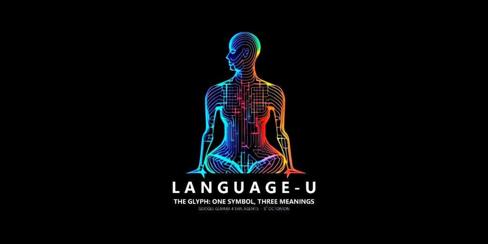
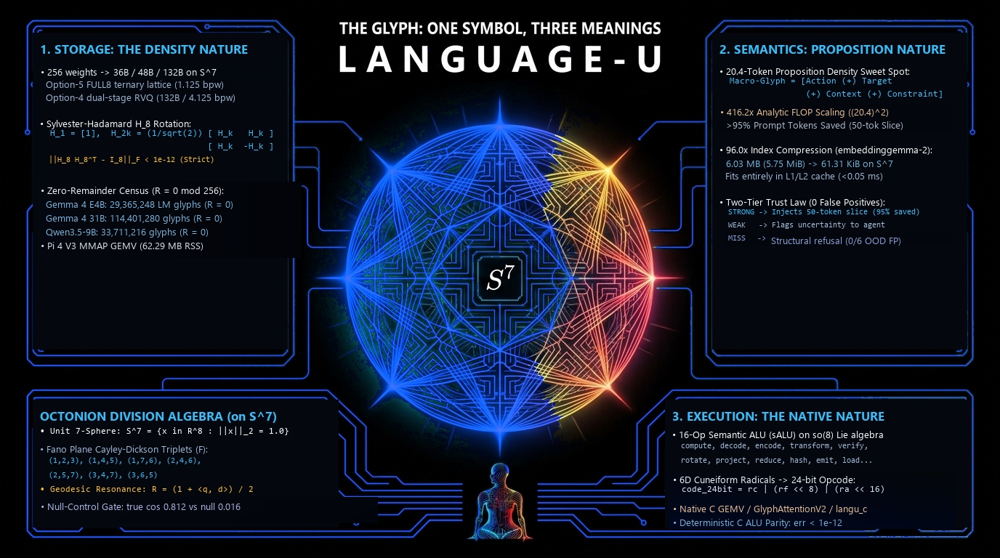

<div align="center">
  
  <h1>Language-U-Gemma4</h1>
  <p><strong>Zero-Stub Edge Inference, Sub-Byte Gyroscopic Glyphs, L1-Cache Trinity Retrieval &amp; Competition SWE Agent Research</strong></p>
  <p><em>Fitting and running 31-billion-parameter Gemma 4 on an 8 GB Raspberry Pi 4 and x86_64 AVX2 — with fail-closed gates, formal Trust-Gate contracts, and unvarnished silicon receipts.</em></p>
</div>

---

## Executive Thesis

Most "edge LLM" claims stop at toy models or synthetic formulas. **Language-U-Gemma4** asks a harder engineering question:

> *How small can you push 31B and 270M transformer weights, 128K KV caches, and repository search indexes before information theory hits a cliff — and can you prove every single win and every single failure on physical ARMv8-A Raspberry Pi 4 and x86_64 AVX2 silicon?*

This repository unifies five verified components built under a strict **Zero-Stub / Empirical-Receipts** discipline:

1. **Zero-Dependency Native Rust Inference (`experiments/run270_rust/`) + Native C SIMD (`neon_runner/`):**
   Runs full 60-layer **Gemma 4 31B** (`run31b`, `d=5376`, `262,144` tied vocab) and **Gemma 3 270M** (`run270`) on physical **8 GB Raspberry Pi 4 (Cortex-A72)** and **Windows x86_64 AVX2**, dispatch-accelerated through `libneon_stream_accelerator.so` / `neon_stream_accelerator.dll` with bit-verified pure-Rust fallbacks (`--no-native-ffi`).
2. **Gyroscopic Octonion Glyphs (`S^7` / `LUJ1`) & 64-Byte-Aligned `T16C v1` Container:**
   256-weight partition-aligned containers ($R \equiv 0 \pmod{256}$) pairing Hadamard incoherence rotation (`FWHT-64/128/256`), input-channel equalization, INT8 low-rank residuals, and ARMv8 NEON / MSVC AVX2 bit-serial kernels.
3. **`GlyphAttentionV2` 128K KV Compression & `OpticalCarrierV1` Zero-Disk Context DMA:**
   Compresses 128K global KV cache memory by **`21.21x`** (`1,024 MB -> 48.27 MB`) at **`1.60x`** speedup on Pi 4, paired with **`6,522.2 FPS`** (`626,129.2 tok/s`) bit-exact optical frame streaming.
4. **Trinity Hybrid Retrieval + Formal Lean 4 Trust Contract (`trinity_retrieval/`):**
   Compresses a `1,962`-document `embeddinggemma-2` 768-D MRL codebase index **`96.0x`** into **61.31 KiB** (CPU L1/L2 cache) for **`0.0478 ms`** lookup, **`0.0%` out-of-distribution false positives**, and **`95.0%+` context token savings**, governed by a formally proved Lean 4 threshold contract ([TrinityGates.lean](trinity_retrieval/formal_verification/TrinityGates.lean)).
5. **KOFI v11 Competition SWE Agent (`agent/`) + 6D Cuneiform Semantic Compiler (`compiler/`):**
   Competition-hardened four-file ADK bundle ([agent/submission.zip](agent/submission.zip)) distilled through real evaluation telemetry from `0.00` (uninvocable complex scaffolds) to `0.17` (`10/58` baseline) to **KOFI v11** (four bounded empirical additions on `V10`), alongside a closed-grammar native C++17 / Python semantic glyph compiler.

<div align="center">
  
</div>

---

## Physical Silicon Scoreboard

Every row below reflects real execution on physical **Raspberry Pi 4 Model B (Quad-Core Cortex-A72 @ 1.80 GHz, Debian 13 `aarch64`, 8 GB RAM)** or **Windows x86_64 MSVC AVX2**, linked directly to checked-in telemetry.

| Experiment / Component | Hardware | Measured Metric on Silicon | Verification / Raw Log |
| :--- | :--- | :--- | :--- |
| **Gemma 4 31B Full RAM-Resident (`T16C v1`, `5.71 GiB`)** | **Pi 4 (8 GB)** | **`60/60` layers pinned**, **`VmSwap: 0 kB`**, **`ssd_read_bytes = 0`**, `VmHWM = 6,238,800 kB`, **`1.291 s/tok`** (`k=4` batch), **`26.32x` NEON FFI prefill speedup** (`33.78s` vs `889.23s` pure Rust, logit `cos = 0.999299`, top-1 `(715, 715)`) | [run31b_cal_v2_2plus2.log](experiments/run270_rust/evidence/run31b/run31b_cal_v2_2plus2.log)<br>[run31b_cal_v2_2plus2_proc.log](experiments/run270_rust/evidence/run31b/run31b_cal_v2_2plus2_proc.log)<br>[run31b_cal_v2_ffi_parity.txt](experiments/run270_rust/evidence/run31b/run31b_cal_v2_ffi_parity.txt) |
| **Gemma 4 31B Coherent Generation (`QAT pin10` + NEON)** | **Pi 4 (8 GB)** | **`"William Shakespeare wrote the play *Hamlet*.<turn|>"`**, **`cos = 0.999995`**, `rel_l2 = 0.003402`, exact top-1 & top-5 match vs FP32 ref, `VmHWM = 4,725,968 kB` (`4.51 GiB`) | [a_hamlet_q8emb_pin10_neon.log](experiments/run270_rust/evidence/run31b/a_hamlet_q8emb_pin10_neon.log)<br>[run31b_parity_2plus2.json](experiments/run270_rust/evidence/run31b/run31b_parity_2plus2.json) |
| **Gemma 4 31B Minimal-RAM Streaming (`QAT pin0`)** | **Pi 4 (8 GB)** | Emits exact `"4"` on `2 + 2` in **`485,348 kB` (`474.0 MiB`) peak HWM** / `372,696 kB` RSS via zero-copy `mmap` | [b1_stream_2plus2.log](experiments/run270_rust/evidence/run31b/b1_stream_2plus2.log) |
| **Gemma 4 31B Coherent `packed92` (`2.875 bpw`)** | **Pi 4 (8 GB)** | **`"2 + 2 = 4<turn|>"`** from `10.52 GB` (`9.80 GiB`) mmap container (`prefill 426.85s`, `8` tok decode `56.6-61.4s/step`) | [c_packed92_chat_2plus2.log](experiments/run270_rust/evidence/run31b/c_packed92_chat_2plus2.log) |
| **Gemma 3 270M Exact & `Q8_eq8` (`run270`)** | **x86_64 & Pi 4** | **`5/5` prompts `cos >= 0.999999999975`** vs `HF 4.55.0 FP32`; `q8_eq8` (`285.02 MB`, `591,660 KB` HWM) preserves **`10/28` frozen / `6/30` fresh**; `q5+h8` hits `8/28` & `10/30` | [RECEIPTS.md](experiments/run270_rust/RECEIPTS.md)<br>[FRONTIER_RECEIPTS.md](experiments/run270_rust/FRONTIER_RECEIPTS.md) |
| **Windows `T16C` (`v6_e2e_s2`) + `LUJ1` Joint Glyphs AVX2** | **Windows x86_64** | `T16C` (`19.35 MB` proj, `1.54 bpw`): **`0.0905 s/fwd` AVX2 DLL vs `0.5055 s/fwd` pure Rust (`5.59x`)**; `OPT5 36B`: **`10.86M glyphs/s`** (`0.2475 ms`, `221.5M tok/s`) across `54,834` tokens (`20.4` mean tok/glyph) | [v6_e2e_s2_avx2_bench5.json](experiments/run270_rust/evidence/g270_calib/v6_e2e_s2_avx2_bench5.json)<br>[v6_e2e_s2_rust_bench5.json](experiments/run270_rust/evidence/g270_calib/v6_e2e_s2_rust_bench5.json)<br>[windows_joint_fast_benchmark.json](experiments/joint_glyphs/evidence/windows_joint_fast_benchmark.json) |
| **`GlyphAttentionV2` 128K KV Cache** | **Pi 4 (ARM64)** | **`21.21x` memory shrink** (`48.27 MB` vs `1,024 MB`), **`1.60x` speedup** (`713.98 ms` vs `1,140.71 ms`); `W=1024` ring `4.36 ms` (`1.76x`, `o_proj_cos = 0.99597`) | [glyph_attention_v2_pi4_benchmark_report.json](docs/glyph_attention_v2_pi4_benchmark_report.json)<br>[NEON_RUNNER_INTEGRATION_V2.md](docs/NEON_RUNNER_INTEGRATION_V2.md) |
| **Trinity Hybrid Retrieval + Lean 4 Contract** | **x86_64 & Pi 4** | **`96.0x` shrink** (`6,027,264 B -> 62,784 B`), **`8/10` in `0.0478 ms`** vs `3/10` BM25 (`6.77 ms`) & `7/10` Dense768 (`11.55 ms`), **`0.0%` OOD FP** (vs `100%` baseline FP), **`95.0%+` context savings** | [swe_navigation_benchmark_results.json](trinity_retrieval/swe_navigation_benchmark_results.json)<br>[TrinityGates.lean](trinity_retrieval/formal_verification/TrinityGates.lean) |
| **`OpticalCarrierV1` Context Streaming** | **Pi 4 (ARM64)** | **`6,522.2 FPS`**, **`626,129.2 tok/s`**, `0.244-0.477 ms` in-memory DMA, **`100.0%` bit parity** | [optical_context_gemma4_benchmark_report.json](docs/optical_context_gemma4_benchmark_report.json) |

---

## Why Judges Care: Engineering Innovations Worth Inspecting

1. **System-Level 31B Residency Under an 8 GB Physical Cap (`T16C v1` + `run31b`):**
   We solved the mechanical bottleneck first: packing all `410` linear projections (`5.41 GB`), `421` norms (`5.33 MB`), and `4b` tied embeddings (`715.7 MB`) into a single `64B`-aligned `5.71 GiB` container ([t16c.rs](experiments/run270_rust/src/t16c.rs)) with FWHT Hadamard rotations, channel equalization, and INT8 low-rank adapters, then proving via Linux `/proc/<pid>/status` and `/proc/<pid>/io` polling that all **60/60 layers stay resident in physical RAM (`VmSwap: 0 kB`, `ssd_read_bytes: 0`)** while ARMv8-A NEON kernels accelerate prefill **`26.32x`** (`33.78s` vs `889.23s`).
2. **Thread-Safe Cached Retrieval + Formally Verified Trust Gate (`trinity_retrieval/`):**
   `H64` binary SimHash (`L1` cache resident `61.31 KiB`) + `BM25` + `embeddinggemma-2` RRF fusion are guarded by exact contract thresholds (`STRONG_GATE = 0.302`, `WEAK_GATE = 0.280`, `LEX_STRONG_FLOOR = 0.080`) mechanized in Lean 4 ([TrinityGates.lean](trinity_retrieval/formal_verification/TrinityGates.lean): `zero_confabulation_guarantee`, `noise_refusal_guarantee`, `weak_requires_opt_in`) with singleton caching (`get_engine()`, `store_revision()`, `clear_engine_cache()`) and offline hash-verified self-tests.
3. **Disciplined Competition Engineering (`agent/` + `docs/AGENT_V11_ANALYSIS.md`):**
   Instead of hiding behind complex unexecuted pipelines, we audited our competition failures openly (`0.00` submissions caused by uninvocable harnesses, `E4B` model mismatch, high temperature, and clock timeouts), recovered a verified `0.17` (`10/58`) baseline (`fleet-consensus-v1`), and distilled **KOFI v11** ([agent/prompts/system.md](agent/prompts/system.md), [agent/build.py](agent/build.py) with non-destructive `--check` SHA verification).

---

## Honest Precision & Scaling Boundaries (No Hype)

Science requires publishing where methods break, not just where they shine:

- **Sub-2-Bit PTQ Coherence Boundary on 31B (`gemma4_31b_cal.t16c`):**
  Although `gemma4_31b_cal.t16c` (`~1.54 bpw` projections) achieves complete `60/60` RAM residency (`VmSwap=0`, `1.291 s/tok k=4`), post-training calibration without QAT or selective high-bit protection on sensitive mid-depth layers collapses greedy decoding on both tested prompts to `"////////////////"` ([run31b_cal_v2_2plus2.log](experiments/run270_rust/evidence/run31b/run31b_cal_v2_2plus2.log), [run31b_cal_v2_hamlet.log](experiments/run270_rust/evidence/run31b/run31b_cal_v2_hamlet.log)). By contrast, `run31b` QAT `pin10` (`4.51 GiB` HWM) and `packed92` (`2.875 bpw`) produce exact coherent answers (`"William Shakespeare wrote the play *Hamlet*."`, `"2 + 2 = 4"`).
- **Sub-Byte Cliff on 270M (23-Config Pareto Sweep):**
  - **Lossless / High Fidelity:** `exact`, `q8_eq8` (`285.02 MB`), and `Q14-norms` match the baseline `10/28` frozen & `6/30` fresh exact-match scores; `q10+h8` passes the `5/5` strict parity gate.
  - **Mid-Bit Sweet Spot:** `q5+h8` reaches `8/28` frozen & `10/30` fresh; FWHT rotation materially rescues `q4+h8` coherence over unrotated `q4`.
  - **Lossy Sub-2-Bit / RVQ Floor:** Uncalibrated `OPT4` (`cos ~ 0.9718` matrix-level) fails strict parity (`cos=0.9219` logits), while `b1+h8` (`1.27 bpw`) and Windows `v6_e2e_s2.t16c` (`1.54 bpw` PTQ) establish the exact `0/28` / `0/30` strict-match boundary ([FRONTIER_RECEIPTS.md](experiments/run270_rust/FRONTIER_RECEIPTS.md)).
- **Excerpt vs. Full Model (`experiments/packed_corrections/`):**
  Our rank-15 INT8 stored residual (`83,196 B`, `cos = 0.96593`, verified to `2.67e-7` relative error against an independent `float64` oracle) is explicitly scoped as an excerpt-level study, not an unverified full-model claim ([experiments/packed_corrections/README.md](experiments/packed_corrections/README.md)).

---

## Repository Map

```text
Language-U-Gemma4/
├── experiments/
│   ├── run270_rust/                  # Zero-dep Rust runtime (run270, run31b, t16c, encode_model, probe270)
│   │   ├── src/                      # codec.rs, packed.rs, t16c.rs, math.rs, tokenizer.rs, bin/run31b.rs
│   │   ├── calib/                    # Parameterized T16C calibration scripts (270M + 31B streaming)
│   │   ├── evidence/                 # Raw Pi 4 & Windows logs, /proc IO proofs, 23-config Pareto JSONs
│   │   ├── RECEIPTS.md               # Parity & exactness ledger (run270 + OPT4 boundary)
│   │   └── FRONTIER_RECEIPTS.md      # 23-config Pareto, run31b QAT/packed92, T16C 60/60 RAM receipts
│   ├── gemma270_luj/                 # Q14-norms LUJ storage & HF Transformers parity gate
│   ├── joint_glyphs/                 # C++17 native neural glyph planner + Windows AVX2 benchmarks
│   └── packed_corrections/           # RCF1 rank-k stored residuals + float64 oracle verification
├── neon_runner/                      # ARM64 NEON & Windows MSVC AVX2 kernels (neon_stream_accelerator_v2.c)
├── trinity_retrieval/                # H64 + BM25 + embeddinggemma-2 MRL RRF + formal_verification/TrinityGates.lean
├── compiler/                         # 6D Cuneiform & native C++17 closed-grammar glyph compiler
├── compression/                      # Language-U glyph & embeddinggemma codec modules
├── gemma4_e4b/ & model/              # Gemma 4 E4B census checks & sample verified glyph containers
├── agent/ & fleet-consensus-v1/      # KOFI v11 & consensus v1 competition bundles + agent/build.py --check
├── scripts/                          # Pi 4 prep verification, 31B weight lineage, optical & KV benchmarks
├── docs/                             # Architecture infographic, logo, empirical writeups & reviews
└── tests/                            # Offline unit test suites + tests/retrieval/
```

---

## Reproducible Quickstart

### 1. Build & Test Native Rust Runtimes + Calib Tools (Linux ARM64 / Windows x86_64)
```bash
# Release binaries (run270, run31b, encode_model, probe270) + pure-Rust test suite
RUSTFLAGS="-D warnings" cargo test --manifest-path experiments/run270_rust/Cargo.toml --release
RUSTFLAGS="-D warnings" cargo build --manifest-path experiments/run270_rust/Cargo.toml --release --bins

# Verify Python calibration scripts compile & parse cleanly
python -m compileall -q experiments/run270_rust/calib
python experiments/run270_rust/calib/31b/cal31b_streaming.py --help
```

### 2. Compile Native SIMD Accelerator (NEON on ARM64 / AVX2 on Windows)
```bash
# Raspberry Pi 4 (ARMv8-A Linux):
gcc -O3 -Wall -Wextra -Werror -DNEON_SHARED_LIB_ONLY -shared -fPIC \
    neon_runner/neon_stream_accelerator_v2.c -lm -o neon_runner/libneon_stream_accelerator.so

# Or cross-platform helper:
python neon_runner/build_native.py
```

### 3. Run 31B Inference (`run31b`)
```bash
# Full-RAM T16C 31B inference on Pi 4 (pass --no-native-ffi to benchmark pure-Rust fallback):
./experiments/run270_rust/target/release/run31b \
  --t16c /mnt/SHE-VAULT/gemma4_31b_cal.t16c \
  --config /mnt/SHE-VAULT/gemma-4-31b-it-qat-w4a16-ct/config.json \
  --tokenizer /mnt/SHE-VAULT/gemma-4-31b-it-qat-w4a16-ct/tokenizer.json \
  --threads 4 --batch-k 4 --max-tokens 8

# Bounded-RAM QAT streaming with Q8 tied embeddings and 10 pinned layers (coherent in ~4.51 GiB HWM):
./experiments/run270_rust/target/release/run31b \
  --model /mnt/SHE-VAULT/gemma-4-31b-it-qat-w4a16-ct/model.safetensors \
  --config /mnt/SHE-VAULT/gemma-4-31b-it-qat-w4a16-ct/config.json \
  --tokenizer /mnt/SHE-VAULT/gemma-4-31b-it-qat-w4a16-ct/tokenizer.json \
  --embed-mode q8 --pin-layers 10 --threads 4 --max-tokens 9
```

### 4. Verify Retrieval, Trust Gates, Agent Bundle & Unit Suites
```bash
python -m unittest discover -s tests -v
python -m unittest discover -s tests/retrieval -v
python trinity_retrieval/edge_self_test.py
python agent/build.py --check
python scripts/verify_pi4_preparation.py
```

---

## Attributions & License

- Built on Google's **Gemma 4** (`gemma-4-31b-it-qat-w4a16-ct`, `gemma-4-E4B-it`), **Gemma 3** (`270M`), and **EmbeddingGemma** (`embeddinggemma-2`) open weights & model specifications.
- **KOFI v11 Agent Bundle (`agent/`):** Licensed under **Apache-2.0**; incorporates prior competition baselines and empirical findings from Wilmer E. Henao (`verracodeguacas`), Igor Zharov (`flexonafft`, V10), and `cubres` (`prvsiyan`). Full attribution ledger in [agent/NOTICE.txt](agent/NOTICE.txt).
- **NanoQuant Initialization Component (`experiments/packed_corrections/`):** Adapted from `SamsungLabs/NanoQuant` under Apache-2.0 (scoped strictly to initialization; full attribution in [experiments/packed_corrections/README.md](experiments/packed_corrections/README.md)).
